# Jornal

[](https://github.com/NicolasSnchz/sanchez-jornal/actions/workflows/ci.yml)

Plataforma web para contratar ayudantes de obra **por días** y llevar cuentas claras de cada jornada, anticipo y liquidación.

El maestro de obra registra las horas de su cuadrilla; el trabajador las **confirma o las objeta** desde su celular. Solo lo que ambos aceptaron cuenta para el saldo, así que el día de pago no hay discusión.

Proyecto de Programación Web, Ingeniería de Sistemas, UDES Cúcuta (2026).


<details>
<summary>Más capturas de la aplicación</summary>

| Panel del maestro | Buscar trabajadores |
|---|---|
|  |  |
| **Comprobante de pago** | **Ingreso** |
|  |  |

| Trabajador en el celular | Confirmar jornadas |
|---|---|
|  |  |

</details>

## Qué hace

**Maestro de obra**

- Registra obras y las divide en **frentes de trabajo** (labor, oficio, cupos, jornal, días y horario).
- Busca trabajadores del mismo oficio y ciudad, y ve **por qué** alguno no es apto (por ejemplo, su ARL vence antes de que termine el frente).
- Anota cada jornada en una **planilla semanal** que dibuja el horario pactado y las horas reales, incluidas las horas extra.
- Da anticipos y hace liquidaciones de periodo o la final; cada pago genera un **comprobante** con el valor en letras y el desglose.
- Su panel le dice qué resolver hoy: jornadas objetadas, días sin registrar, saldos por pagar.

**Trabajador**

- Recibe invitaciones con el jornal, el horario y las fechas, y decide si acepta.
- Ve cuánto le deben y confirma u objeta cada jornada (con el motivo).
- Confirma los pagos que recibe y califica al maestro al terminar.

Las reglas siguen la ley colombiana vigente en 2026: jornada diurna de 6:00 a. m. a 7:00 p. m., máximo 42 horas semanales, máximo 2 horas extra diarias con recargo del 25 %, jornal no menor al salario mínimo por hora, festivos calculados automáticamente, trabajadores mayores de edad y con ARL vigente. El detalle está en [docs/diseno.md](docs/diseno.md).

## Cómo ejecutarlo

### Con Maven (lo más rápido)

Requisitos: **JDK 17 o superior** (se probó con 17, 21 y 25) y **Maven 3.9**.

```bash
mvn spring-boot:run
```

Abre <http://localhost:8080>. Sin configurar nada arranca con el perfil `dev`: base H2 en memoria y datos de demostración relativos a la fecha de hoy.

| Rol | Correo | Clave |
|---|---|---|
| Maestro | `maestro@jornal.co` | `Jornal2026*` |
| Trabajador | `trabajador@jornal.co` | `Jornal2026*` |
| Otro maestro (para probar el aislamiento) | `maestra2@jornal.co` | `Jornal2026*` |

Con la aplicación corriendo también están:

- Swagger UI: <http://localhost:8080/swagger-ui.html> (botón **Authorize** con el token de `POST /api/auth/login`).
- Salud e información (Actuator): <http://localhost:8080/actuator/health> y <http://localhost:8080/actuator/info>.
- Logs: en la consola y en el archivo `logs/jornal.log` (rota cada día y guarda 30 días).

### Con Docker (PostgreSQL, como en producción)

Requisito: Docker Desktop o Docker Engine con Compose.

```bash
cp .env.example .env
docker compose up --build
```

En Windows con CMD el primer paso es `copy .env.example .env`. El archivo `.env` guarda las claves y no se sube al repositorio; los valores de ejemplo sirven para probar, pero en un servidor real se cambian.

Abre <http://localhost:8080> con los mismos usuarios de arriba. Compose levanta PostgreSQL 16 y la aplicación con los perfiles `prod` y `demo`: la base es PostgreSQL con Flyway, los secretos llegan por variables de entorno y se cargan los datos de demostración solo la primera vez (si la base ya tiene usuarios no se duplica nada). Para un despliegue real se pone `SPRING_PROFILES_ACTIVE=prod` en el `.env` y la aplicación arranca vacía y sin Swagger.

- `docker compose logs -f app` muestra los logs; el archivo queda en el volumen `jornal-logs`.
- `docker compose down` apaga todo y conserva los datos; `docker compose down -v` también borra la base.

### Perfiles

| Perfil | Base de datos | Datos de demo | Swagger | Actuator | Para qué |
|---|---|---|---|---|---|
| `dev` (por defecto) | H2 en memoria | Sí | Sí | `health`, `info`, `metrics`, `flyway`, `mappings` | Programar y revisar |
| `prod` | PostgreSQL | No | No | Solo `health` e `info` | Servidor real; sin secretos por defecto: si falta uno, no arranca |
| `demo` | La del otro perfil | Sí | Sí | La del otro perfil | Se suma a `prod` para presentar (`prod,demo`) |
| `test` | H2 en memoria propia de cada prueba | No | No | | Solo lo usan las pruebas |

### Pruebas

```bash
mvn verify
```

Corre las pruebas unitarias, de integración y de punta a punta, y **falla si la cobertura de líneas baja del 70 %** (JaCoCo). El reporte queda en `target/site/jacoco/index.html`.

Al momento de la entrega: 297 pruebas, todas pasan, con 89 % de cobertura de líneas y 76 % de ramas. Para ver la regla de cobertura en acción, `mvn verify -Djacoco.minimum=0.99` debe fallar.

### API con Postman o Newman

Con la aplicación corriendo (con Maven o con Docker):

```bash
npx newman run postman/jornal.postman_collection.json -e postman/jornal-local.postman_environment.json
```

La colección (20 peticiones, cada una con su script de prueba) revisa el login con JWT, los roles, los códigos de error (400, 401, 403, 404, 422) y el flujo del maestro y del trabajador. También se puede importar en Postman y correr con el Runner.

## Cómo está construido

```text
 Navegador (Thymeleaf)                     App móvil / Postman (JSON)
        │                                            │
 Cadena web: sesión + CSRF  (@Order 2)     Cadena API: JWT sin estado  (@Order 1)
        │                                            │
 controller.web ──────────────┐    ┌──────────── controller.api
                              ▼    ▼
                    service (interfaces, @PreAuthorize, @Transactional)
                              │
             ┌────────────────┼─────────────────┐
             ▼                ▼                 ▼
         strategy          entity            repository ──► PostgreSQL / H2 (Flyway)
   (un pago por clase)  (reglas del negocio)  (Spring Data JPA)
```

| Capa | Paquete | Qué contiene |
|---|---|---|
| Dominio | `entity` | Entidades JPA **con sus reglas** (`Assignment.registerWorkDay`, `WorkFront`, `Payment.cancel`…). Se prueban sin base de datos. |
| Estrategias | `strategy` | Un tipo de pago por clase: anticipo, liquidación de periodo y liquidación final (patrón Strategy). |
| Servicios | `service`, `service.impl` | Casos de uso con `@Transactional` y `@PreAuthorize`; interfaces separadas por área. |
| Persistencia | `repository` | Spring Data JPA; cada consulta filtra por el dueño del recurso. |
| Web | `controller.web` | Controladores MVC con Thymeleaf (sesión + CSRF). |
| API | `controller.api` | REST con JWT, documentada con OpenAPI. |
| DTO | `dto.form`, `dto.view`, `dto.api` | Entrada validada, modelos de lectura y contratos de la API. Las entidades nunca llegan a la vista. |
| Seguridad | `security`, `config` | Dos cadenas de filtros, JWT, bloqueo por intentos, propiedades tipadas. |
| Errores | `exception` | `@RestControllerAdvice` (JSON uniforme) y `@ControllerAdvice` (páginas). |

Esquema de la base de datos versionado con **Flyway** (`src/main/resources/db/migration`); Hibernate solo lo valida. Los diagramas de clases, estados y arquitectura están en [docs/diseno.md](docs/diseno.md).

## Seguridad: por qué sesión y JWT a la vez

Jornal tiene dos tipos de cliente y cada uno necesita algo distinto:

- **El navegador** usa sesión con cookie. El usuario entra una vez y navega; la cookie es `HttpOnly` (JavaScript no la puede leer) y como el navegador la manda sola en cada petición, todo formulario lleva token **CSRF**.
- **La API** (pensada para una app móvil o para Postman) es **sin estado** con JWT. Cada petición trae `Authorization: Bearer ...`, el servidor no guarda sesiones y no hace falta CSRF porque el token no viaja solo.

Por eso hay dos `SecurityFilterChain` con `@Order` explícito: [la de la API](src/main/java/com/jornal/config/SecurityConfig.java#L93) atiende solo `/api/**` y va primero; [la web](src/main/java/com/jornal/config/SecurityConfig.java#L117) atiende todo lo demás. No se mezclan: la cookie de sesión no abre la API y el token no abre las páginas. Eso está probado en [`sesionWebYTokenJwt_alMismoTiempo_cadaUnoSoloAbreSuPropiaCadena`](src/test/java/com/jornal/api/ApiIT.java#L115).

Las dos cadenas usan el mismo `AuthenticationManager`, así que BCrypt, el bloqueo tras 5 intentos fallidos y las cuentas desactivadas funcionan igual en ambos canales. Encima de las URL, cada método de servicio tiene `@PreAuthorize`, que además exige que el id recibido sea el del usuario autenticado. Un recurso ajeno responde 404 y no 403, para no confirmar que existe.

Contra OWASP: consultas JPQL con parámetros (nunca concatenadas), Thymeleaf escapa todo con `th:text` (no hay ni un `th:utext`), CSP estricta sin scripts ni estilos en línea, Actuator limitado, errores sin stack trace y logs con ids en vez de correos, claves o tokens. El detalle por riesgo está en [docs/diseno.md](docs/diseno.md#6-seguridad-owasp-top-10).

## Pruebas: qué se prueba y con qué

| Tipo | Anotaciones | Por qué así | Clases |
|---|---|---|---|
| Dominio | JUnit 5, `@ParameterizedTest` | Las reglas viven en las entidades, así que se prueban con objetos normales, sin Spring ni base de datos. Son las más rápidas y las más numerosas. | [`entity`](src/test/java/com/jornal/entity), [`strategy`](src/test/java/com/jornal/strategy), [`util`](src/test/java/com/jornal/util) |
| Servicios | `@ExtendWith(MockitoExtension.class)`, `@Mock`, `@InjectMocks` | Se simula solo lo que está fuera del servicio (repositorios) para probar la orquestación y los casos de error sin levantar la aplicación. [`ProfileServiceImplTest`](src/test/java/com/jornal/service/ProfileServiceImplTest.java) usa `@InjectMocks`; los demás arman el servicio a mano porque reciben colaboradores reales (reloj fijo, `ViewMapper`, estrategias) que no tiene sentido simular. | [`service`](src/test/java/com/jornal/service) |
| Repositorios | `@DataJpaTest` con `TestEntityManager` | Levanta solo JPA y Flyway sobre H2: prueba consultas reales, el filtro por dueño y la búsqueda con `' OR '1'='1`. | [`RepositoryQueriesTest`](src/test/java/com/jornal/repository/RepositoryQueriesTest.java) |
| Controlador aislado | `@WebMvcTest` + `@MockitoBean` | Solo la capa web con la seguridad real y los servicios simulados: verifica cada código HTTP (200, 201, 400, 401, 403, 404, 409, 422, 500) sin depender de datos. | [`ForemanApiControllerTest`](src/test/java/com/jornal/api/ForemanApiControllerTest.java) |
| Integración | `@SpringBootTest` + MockMvc | Toda la aplicación junta: JWT real, sesión, CSRF, bloqueo, IDOR, XSS y un flujo completo de una asignación con el reloj avanzando día a día. | [`web`](src/test/java/com/jornal/web), [`ApiIT`](src/test/java/com/jornal/api/ApiIT.java), [`PayrollFlowIT`](src/test/java/com/jornal/integration/PayrollFlowIT.java) |
| Punta a punta | Selenium (HtmlUnit) con Page Objects | Un flujo real en el navegador: el trabajador objeta, el maestro corrige y el trabajador confirma. | [`e2e`](src/test/java/com/jornal/e2e) |
| API externa | Postman / Newman | La misma API contra la aplicación corriendo, también en CI contra Docker. | [`postman`](postman) |

**¿Por qué sí Selenium?** A diferencia de una API pura, Jornal tiene vistas Thymeleaf reales y su flujo más importante (objetar y corregir una jornada) pasa por dos usuarios en el navegador. Se usa HtmlUnit como navegador para que la prueba corra en cualquier PC y en CI sin instalar Chrome. Es una sola prueba de punta a punta, como pide la pirámide: el resto de la interfaz lo cubre [`PagesRenderIT`](src/test/java/com/jornal/web/PagesRenderIT.java#L50), que renderiza cada pantalla de cada rol y falla si falta un texto.

**Orden en que se armó la suite.** Primero las de dominio (son la base y obligan a que las reglas no dependan de Spring), después servicios con Mockito, luego repositorios y web, y al final integración y punta a punta. JaCoCo se configuró al cerrar porque el umbral solo tiene sentido cuando ya están todas las capas; antes habría obligado a escribir pruebas para llenar un número.

Los nombres siguen el patrón `metodo_condicion_resultado`, por ejemplo `register_pagoQueNoCumpleLasReglas_noGastaUnNumeroDeComprobante`.

## Temas del curso y dónde están

Cada enlace lleva a la línea donde se ve el tema.

| Guía | Tema | Dónde |
|---|---|---|
| U9 | Dos cadenas de filtros con `@Order`: API con JWT y web con sesión | [`apiFilterChain`](src/main/java/com/jornal/config/SecurityConfig.java#L93), [`webFilterChain`](src/main/java/com/jornal/config/SecurityConfig.java#L117) |
| U9 | Seguridad por método | [`Policies.FOREMAN_SELF`](src/main/java/com/jornal/security/Policies.java#L13) usada con `@PreAuthorize` en [`PaymentService`](src/main/java/com/jornal/service/PaymentService.java#L17) y los demás servicios |
| U9 | BCrypt y bloqueo por intentos fallidos | [`passwordEncoder`](src/main/java/com/jornal/config/SecurityConfig.java#L63), [`LoginAttemptListener`](src/main/java/com/jornal/security/LoginAttemptListener.java#L21), [`User.registerFailedLogin`](src/main/java/com/jornal/entity/User.java#L128) |
| U9 | JWT para la API | [`JwtService.generateToken`](src/main/java/com/jornal/security/JwtService.java#L46), [`JwtAuthFilter`](src/main/java/com/jornal/security/JwtAuthFilter.java#L43) |
| U9 | OWASP: IDOR, XSS, inyección, CSRF, CSP | consultas con dueño como [`findByIdAndFrontSiteForemanId`](src/main/java/com/jornal/repository/AssignmentRepository.java#L19), [CSP estricta](src/main/java/com/jornal/config/SecurityConfig.java#L146), pruebas en [`IdorAndXssIT`](src/test/java/com/jornal/web/IdorAndXssIT.java) y [`WebSecurityIT`](src/test/java/com/jornal/web/WebSecurityIT.java) |
| U10 | Pruebas unitarias y parametrizadas del dominio | [`entity`](src/test/java/com/jornal/entity), [`strategy`](src/test/java/com/jornal/strategy), [`util`](src/test/java/com/jornal/util) |
| U10 | Mockito | [`service/*ServiceImplTest`](src/test/java/com/jornal/service) |
| U10 | `@DataJpaTest`, `@WebMvcTest`, MockMvc | [`RepositoryQueriesTest`](src/test/java/com/jornal/repository/RepositoryQueriesTest.java), [`ForemanApiControllerTest`](src/test/java/com/jornal/api/ForemanApiControllerTest.java), [`PayrollFlowIT`](src/test/java/com/jornal/integration/PayrollFlowIT.java) |
| U10 | Selenium con Page Objects | [`ForemanCorrectsDisputeE2E`](src/test/java/com/jornal/e2e/ForemanCorrectsDisputeE2E.java), [`e2e/pages`](src/test/java/com/jornal/e2e/pages) |
| U10 | Postman / Newman | [`postman/`](postman) (colección y entorno) |
| U10 | Cobertura mínima con JaCoCo | [`pom.xml`](pom.xml#L207) |
| U11 | SOLID | [docs/diseno.md](docs/diseno.md#solid-en-el-código) |
| U11 | DTO y validación | [`dto/form`](src/main/java/com/jornal/dto/form) con Bean Validation, [`dto/view`](src/main/java/com/jornal/dto/view), [`dto/api`](src/main/java/com/jornal/dto/api) |
| U11 | Patrón Strategy | [`PaymentStrategy`](src/main/java/com/jornal/strategy/PaymentStrategy.java#L14), elegida por tipo en [`PaymentServiceImpl`](src/main/java/com/jornal/service/impl/PaymentServiceImpl.java#L57) |
| U11 | Manejo de errores | [`ApiExceptionHandler`](src/main/java/com/jornal/exception/ApiExceptionHandler.java#L37) (JSON uniforme con 400, 401, 403, 404, 409, 422 y 500), [`WebExceptionHandler`](src/main/java/com/jornal/exception/WebExceptionHandler.java#L23) (páginas) |
| U11 | Logging | SLF4J con `{}` en servicios y seguridad, [`logback-spring.xml`](src/main/resources/logback-spring.xml) con consola y archivo rotativo |
| U11 | Swagger / OpenAPI | [`OpenApiConfig`](src/main/java/com/jornal/config/OpenApiConfig.java#L48), `@Tag`, `@Operation` y `@ApiResponse` en [`controller/api`](src/main/java/com/jornal/controller/api), `@Schema` con ejemplos en [`dto/form`](src/main/java/com/jornal/dto/form) |
| U12 | Perfiles dev, prod y demo | [`application-dev.properties`](src/main/resources/application-dev.properties), [`application-prod.properties`](src/main/resources/application-prod.properties), [`application-demo.properties`](src/main/resources/application-demo.properties) |
| U12 | Docker | [`Dockerfile`](Dockerfile) (multietapa, usuario sin privilegios), [`docker-compose.yml`](docker-compose.yml) |
| U12 | CI/CD | [`ci.yml`](.github/workflows/ci.yml): pruebas en Java 17 y 21 con cobertura, `docker compose` con PostgreSQL y Newman, y si todo pasa publica la imagen en GitHub Packages |
| U12 | Actuator | `management.*` en cada perfil y `HEALTHCHECK` en el [`Dockerfile`](Dockerfile) |

### Reglas del negocio que vale la pena mirar

- [`Assignment.registerWorkDay`](src/main/java/com/jornal/entity/Assignment.java#L200): no deja anotar domingos, festivos, días fuera del frente ni más de 2 horas extra.
- [`ColombianHolidays`](src/main/java/com/jornal/util/ColombianHolidays.java#L25): calcula los festivos de cualquier año (ley Emiliani y Semana Santa).
- [`WagePolicy.minimumDailyWage`](src/main/java/com/jornal/service/WagePolicy.java#L29): el jornal mínimo según el salario mínimo y las horas del horario.
- [`findForPayment`](src/main/java/com/jornal/repository/AssignmentRepository.java#L26): bloqueo optimista para que dos pagos simultáneos no usen el mismo saldo.
- [`Payment.cancel`](src/main/java/com/jornal/entity/Payment.java#L107): un pago solo se anula si no deja las cuentas inconsistentes.

## Evidencias

Todas salen de ejecuciones reales de esta versión del proyecto.

<details>
<summary>U9: seguridad (JWT, CSRF, XSS, inyección SQL)</summary>

**JWT:** el login entrega el token; con el token la API responde 200, sin token o con el token alterado responde 401 con el mismo formato de error.

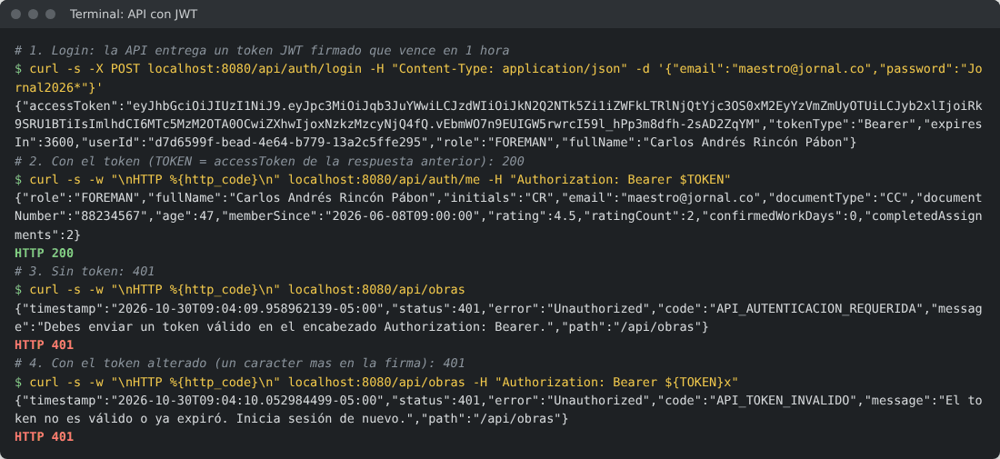

**CSRF:** con la sesión iniciada, cerrar sesión sin el token CSRF responde 403; con el token (como lo manda el formulario) funciona y redirige a `/login?salida`.

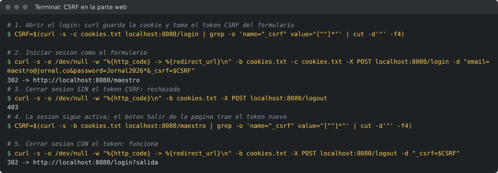

**XSS:** una obra con nombre `<script>alert('XSS')</script>` se muestra como texto. Además la CSP no permitiría ejecutar un script en línea aunque llegara al HTML.

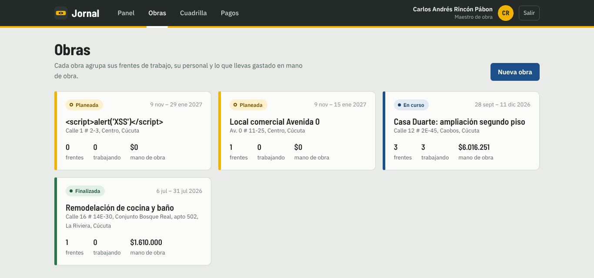

**Inyección SQL:** buscar `' OR '1'='1` entre los candidatos no devuelve a todos los trabajadores: la consulta usa parámetros y el texto se trata como texto.

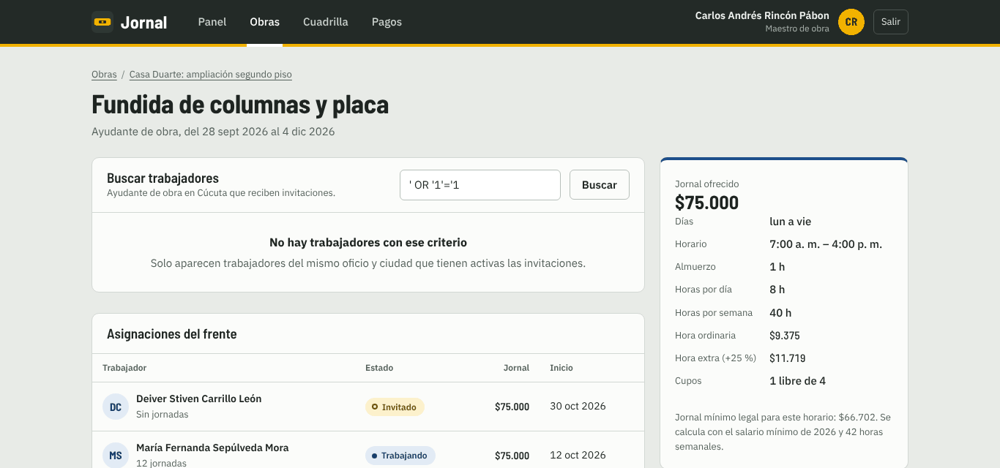

</details>

<details>
<summary>U10: pruebas, cobertura y Postman</summary>

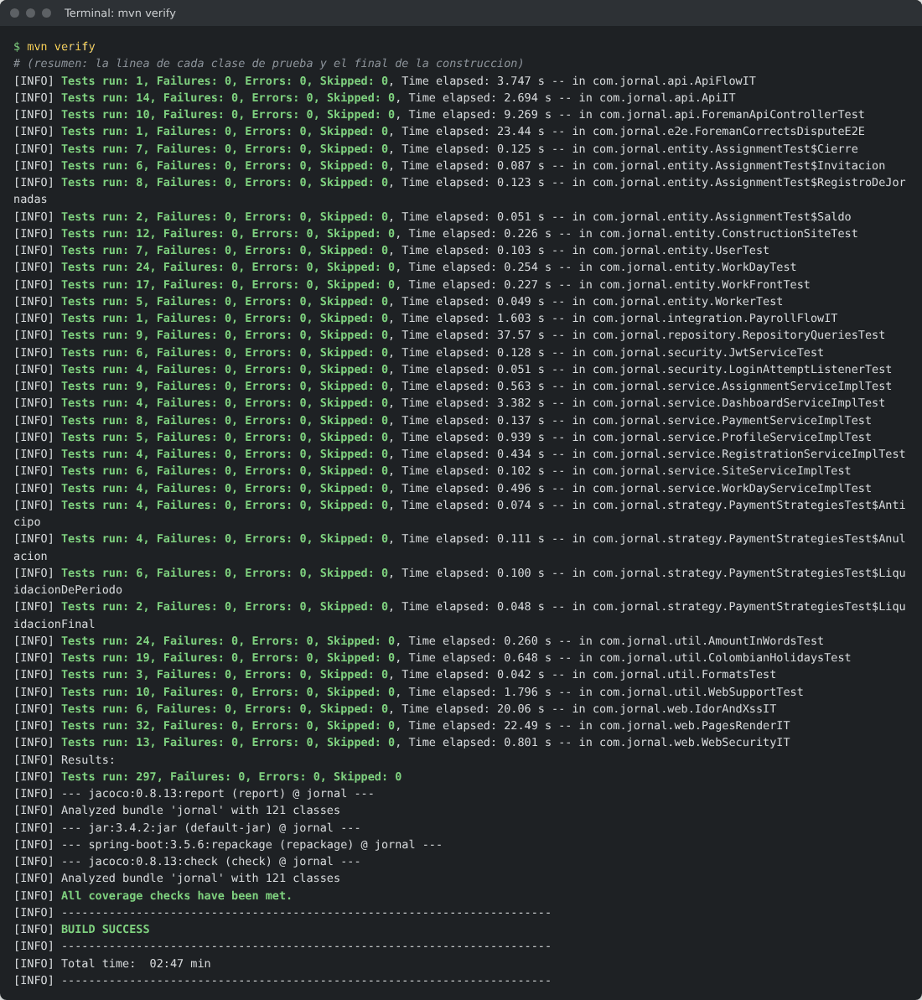

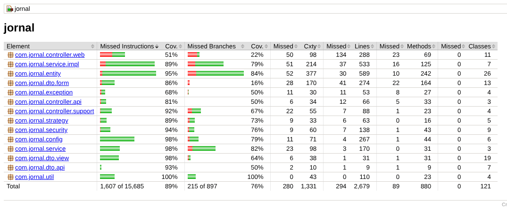

`mvn verify -Djacoco.minimum=0.99` falla por la regla de cobertura:

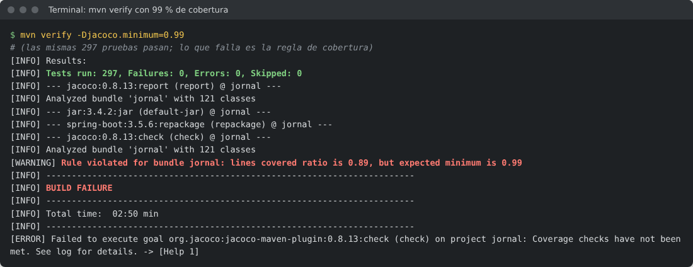

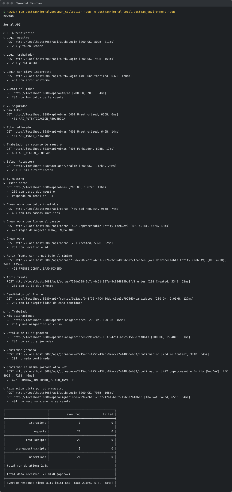

</details>

<details>
<summary>U11: errores, logs y Swagger</summary>

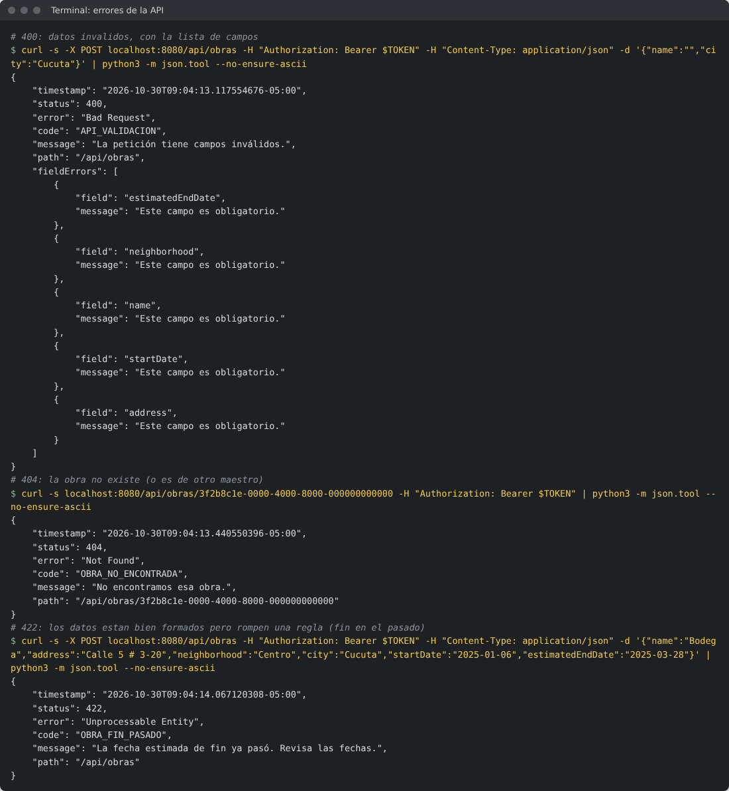

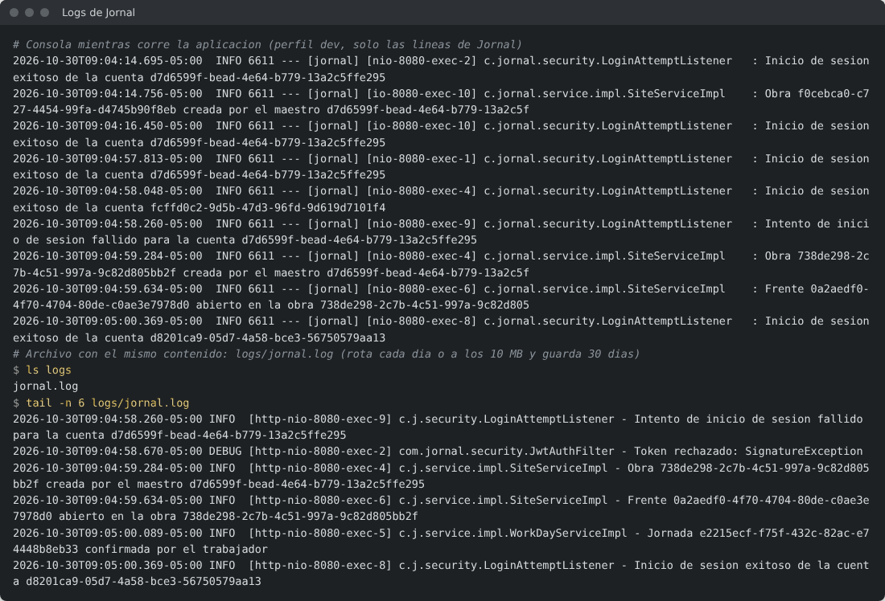

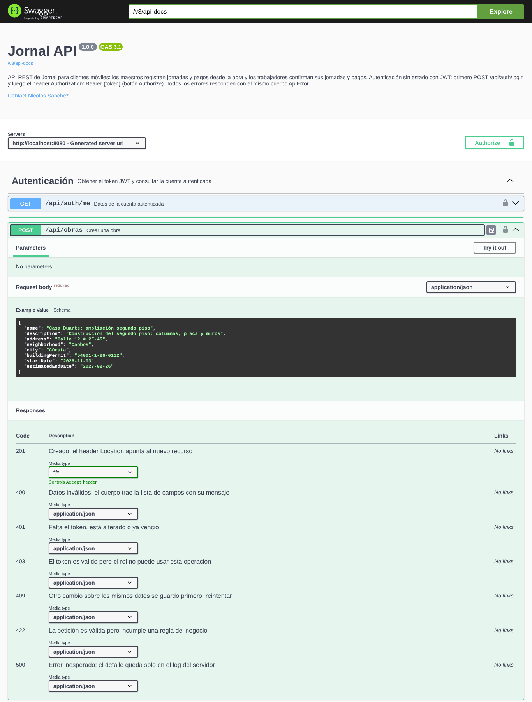

</details>

<details>
<summary>U12: Actuator y perfiles</summary>

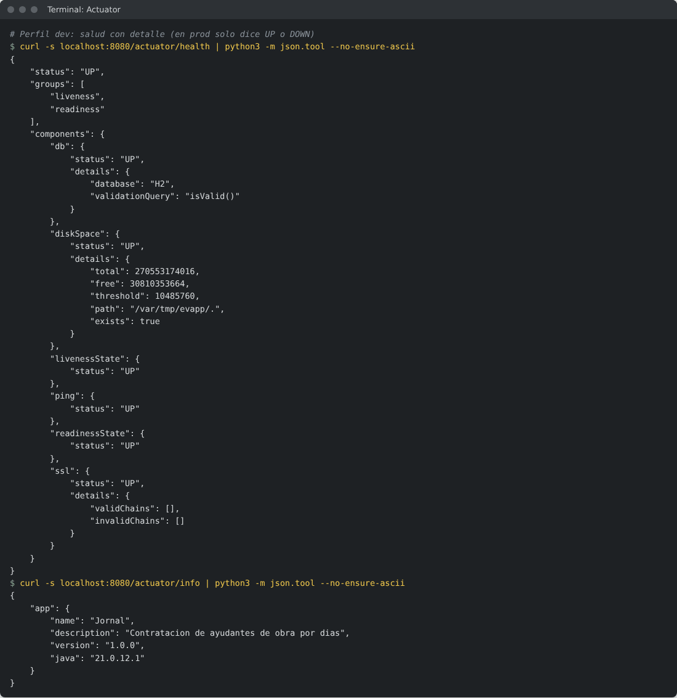

</details>

## Decisiones de diseño

Lo que se hizo distinto a lo literal de las guías, y por qué:

- **Flyway en lugar de `ddl-auto=update`.** En producción Hibernate solo valida el esquema; los cambios a la base quedan versionados y revisables. La misma migración corre en H2 (modo PostgreSQL) y en PostgreSQL.
- **PostgreSQL en producción** y H2 solo para desarrollo y pruebas.
- **Java 17 como mínimo.** Es la versión de las guías; el proyecto compila para 17 y CI lo prueba con 17 y con 21. La imagen Docker usa Java 21.
- **Fechas en español fijas en el código.** Los meses y días abreviados no se toman del JDK, porque Java 17 escribe "sep." y Java 21 "sept"; así la aplicación se ve igual en cualquier versión.
- **Perfil `demo` aparte.** `prod` nunca carga datos ni publica Swagger; para presentar se suma `demo` en vez de aflojar `prod`.
- **Imagen de compilación `maven:3.9-eclipse-temurin-21`.** La imagen `eclipse-temurin:21-jdk` de la guía no trae Maven; la etapa final usa solo el JRE con un usuario sin privilegios que solo puede escribir en `/app/logs`.
- **Actuator sin `*`.** Exponer todos los endpoints publica `env` y `configprops`, que muestran secretos. En producción solo `health` e `info`.
- **Recurso ajeno = 404, no 403.** Un 403 confirmaría que el recurso existe.
- **Errores de la API documentados una sola vez.** Todas las respuestas de error salen del mismo `ApiExceptionHandler` con el mismo cuerpo `ApiError`; en vez de repetir 7 `@ApiResponse` en 26 operaciones, [`OpenApiConfig`](src/main/java/com/jornal/config/OpenApiConfig.java#L71) los agrega según lo que recibe cada operación. Los códigos de éxito (201, 204) sí van anotados en cada método.
- **Sin `try/catch` en los controladores de la API.** Hasta el login deja que la excepción llegue al `@RestControllerAdvice`. En los formularios web sí se atrapa la regla de negocio, pero solo para mostrarla junto al campo sin que el usuario pierda lo que escribió.
- **`@MockitoBean` en lugar de `@MockBean`**, que está deprecado desde Spring Boot 3.4.
- **JaCoCo 0.8.13**, la versión que soporta los JDK recientes.
- **Reloj inyectado** (`Clock`) en lugar de `LocalDate.now()`: las reglas que dependen de "hoy" se pueden probar.
- **Sin estilos ni scripts en línea** en las plantillas: permite una política CSP estricta, que es la defensa más fuerte contra XSS.

## Autor

Nicolás Sánchez, [nicosanchezvil@gmail.com](mailto:nicosanchezvil@gmail.com)
