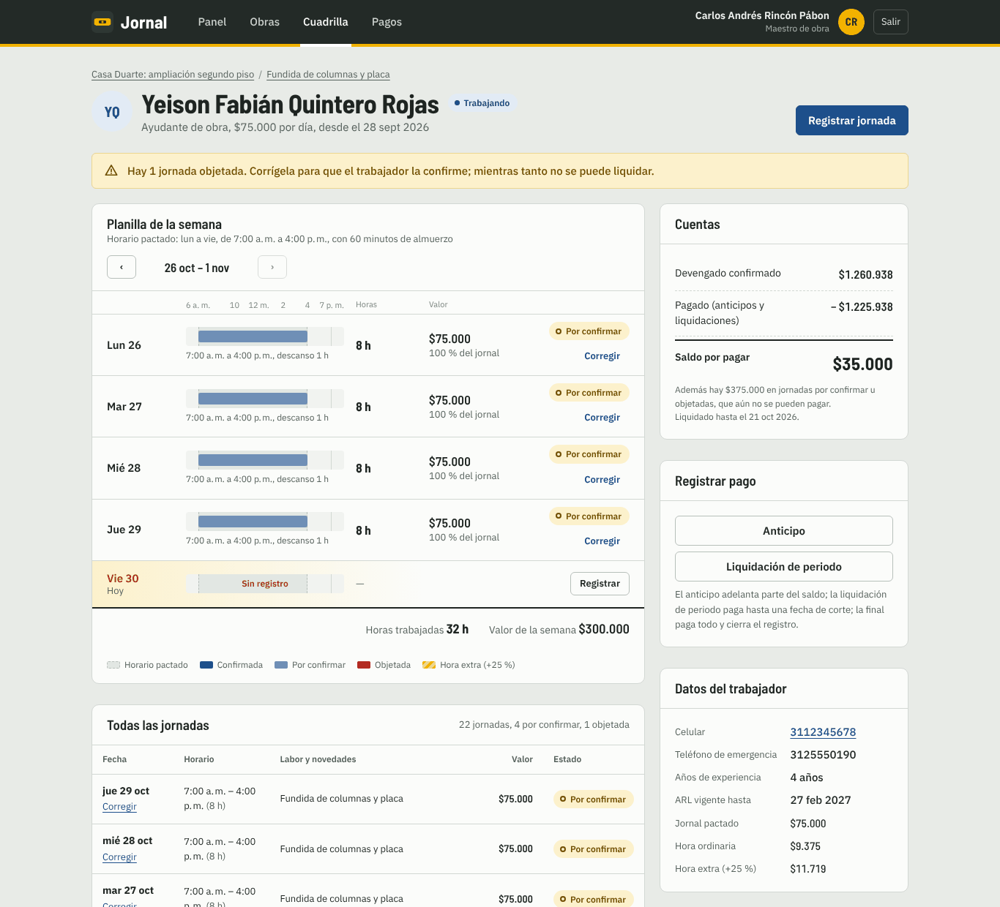
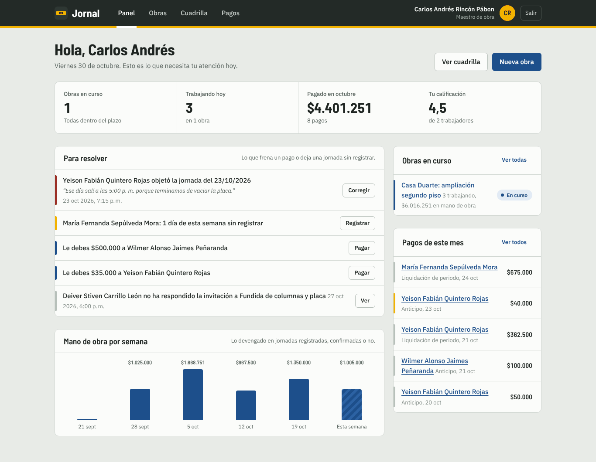
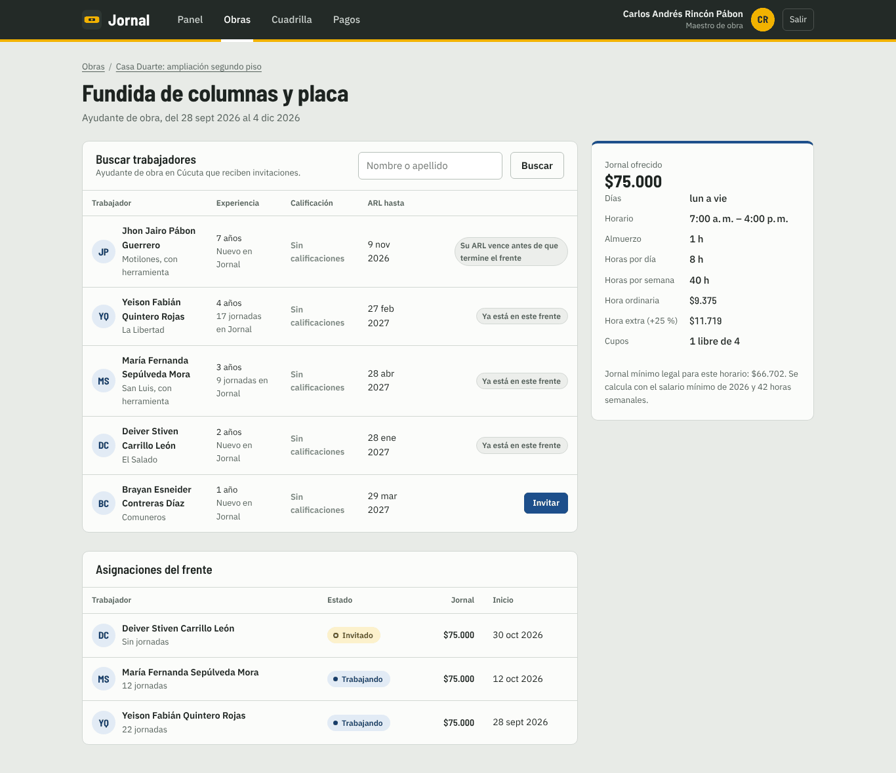
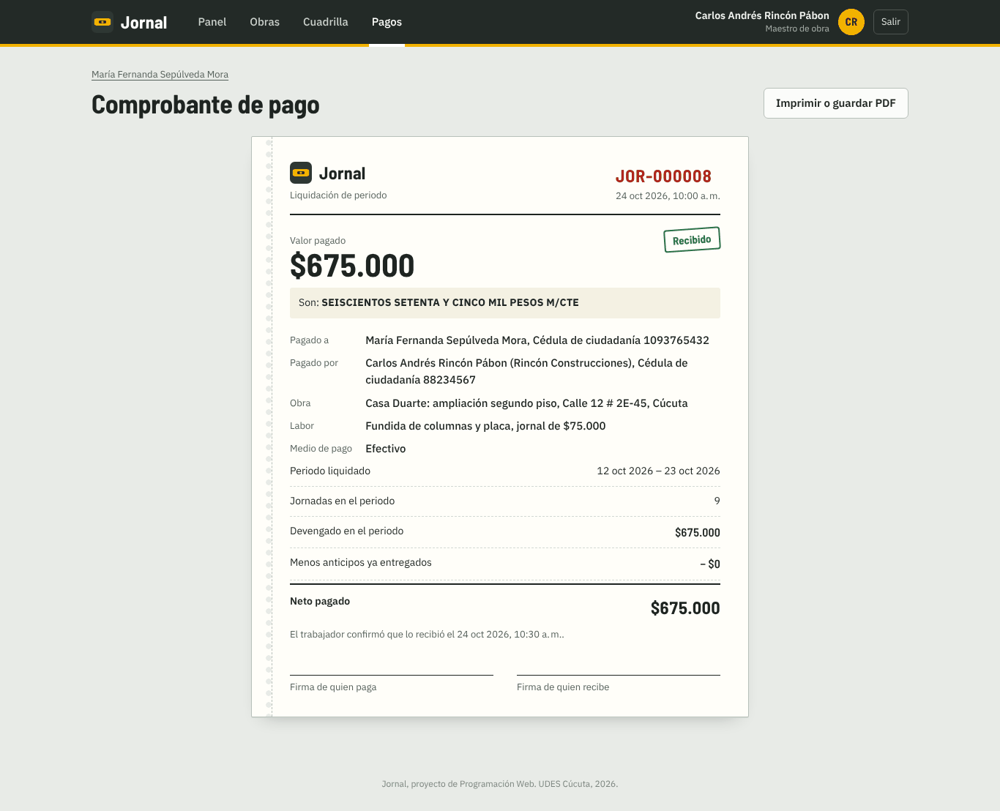
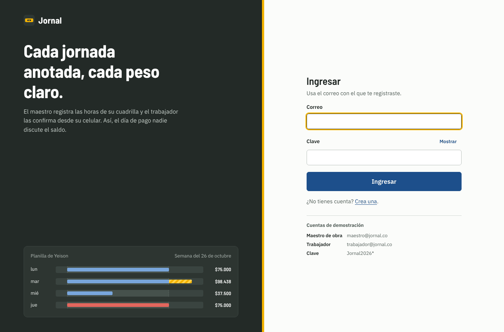
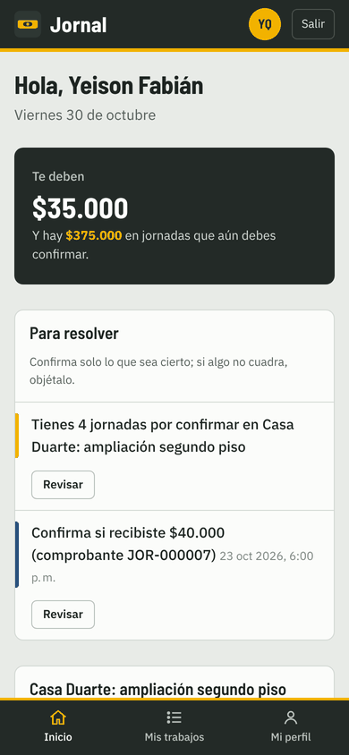
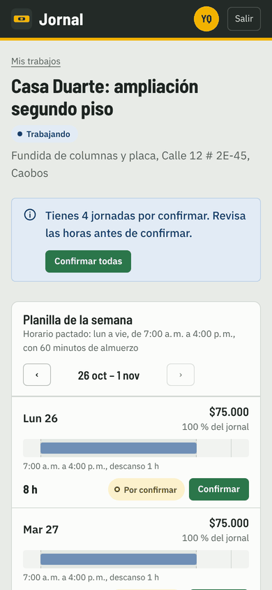

# Jornal

[](https://github.com/NicolasSnchz/sanchez-jornal/actions/workflows/ci.yml)

Plataforma web para contratar ayudantes de obra **por días** y llevar cuentas claras de cada jornada, anticipo y liquidación.

El maestro de obra registra las horas de su cuadrilla; el trabajador las **confirma o las objeta** desde su celular. Solo lo que ambos aceptaron cuenta para el saldo, así que el día de pago no hay discusión.

Proyecto de Programación Web, Ingeniería de Sistemas, UDES Cúcuta (2026).



<details>
<summary>Más capturas</summary>

| Panel del maestro | Buscar trabajadores |
|---|---|
|  |  |
| **Comprobante de pago** | **Ingreso** |
|  |  |

| Trabajador en el celular | Confirmar jornadas |
|---|---|
|  |  |

</details>

## Qué hace

**Maestro de obra**

- Registra obras y las divide en **frentes de trabajo** (labor, oficio, cupos, jornal, días y horario).
- Busca trabajadores del mismo oficio y ciudad, y ve **por qué** alguno no es apto (por ejemplo, su ARL vence antes de que termine el frente).
- Anota cada jornada en una **planilla semanal** que dibuja el horario pactado y las horas reales, incluidas las horas extra.
- Da anticipos y hace liquidaciones de periodo o la final; cada pago genera un **comprobante** con el valor en letras y el desglose.
- Su panel le dice qué resolver hoy: jornadas objetadas, días sin registrar, saldos por pagar.

**Trabajador**

- Recibe invitaciones con el jornal, el horario y las fechas, y decide si acepta.
- Ve cuánto le deben y confirma u objeta cada jornada (con el motivo).
- Confirma los pagos que recibe y califica al maestro al terminar.

Las reglas siguen la ley colombiana vigente en 2026: jornada diurna de 6:00 a. m. a 7:00 p. m., máximo 42 horas semanales, máximo 2 horas extra diarias con recargo del 25 %, jornal no menor al salario mínimo por hora, festivos calculados automáticamente, trabajadores mayores de edad y con ARL vigente. El detalle está en [docs/diseno.md](docs/diseno.md).

## Cómo ejecutarlo

Requisitos: **JDK 21** (o superior) y **Maven 3.9**.

```bash
mvn spring-boot:run
```

Abre <http://localhost:8080>. El perfil `dev` arranca con una base H2 en memoria y datos de demostración relativos a la fecha de hoy:

| Rol | Correo | Clave |
|---|---|---|
| Maestro | `maestro@jornal.co` | `Jornal2026*` |
| Trabajador | `trabajador@jornal.co` | `Jornal2026*` |
| Otro maestro (para probar el aislamiento) | `maestra2@jornal.co` | `Jornal2026*` |

En `dev` también están la documentación de la API en <http://localhost:8080/swagger-ui.html> y la salud de la aplicación en <http://localhost:8080/actuator/health>.

### Pruebas

```bash
mvn verify
```

Corre las pruebas unitarias, de integración y de punta a punta, y **falla si la cobertura de líneas baja del 70 %** (JaCoCo). El reporte queda en `target/site/jacoco/index.html`.

Al momento de la entrega: 288 pruebas, todas pasan, con 87 % de cobertura de líneas y 75 % de ramas.

Para ver la regla de cobertura en acción: `mvn verify -Djacoco.minimum=0.99` debe fallar.

### API con Postman o Newman

Con la aplicación corriendo en `dev`:

```bash
npx newman run postman/jornal.postman_collection.json -e postman/jornal-local.postman_environment.json
```

La colección (21 peticiones) prueba el login con JWT, los roles, los códigos de error (400, 401, 403, 404, 422) y el flujo del maestro y del trabajador. También se puede importar en Postman.

### Producción con Docker

```bash
cp .env.example .env      # y cambia las claves
docker compose up --build
```

Levanta PostgreSQL y la aplicación con el perfil `prod`: secretos solo por variables de entorno, Swagger apagado y Actuator limitado a `health` e `info`.

## Cómo está construido

| Capa | Paquete | Qué contiene |
|---|---|---|
| Dominio | `entity` | Entidades JPA **con sus reglas** (`Assignment.registerWorkDay`, `WorkFront`, `Payment.cancel`…). Se prueban sin base de datos. |
| Estrategias | `strategy` | Un tipo de pago por clase: anticipo, liquidación de periodo y liquidación final (patrón Strategy). |
| Servicios | `service`, `service.impl` | Casos de uso con `@Transactional` y `@PreAuthorize`; interfaces separadas por área. |
| Persistencia | `repository` | Spring Data JPA; cada consulta filtra por el dueño del recurso. |
| Web | `controller.web` | Controladores MVC con Thymeleaf (sesión + CSRF). |
| API | `controller.api` | REST con JWT, documentada con OpenAPI. |
| DTO | `dto.form`, `dto.view`, `dto.api` | Entrada validada, modelos de lectura y contratos de la API. Las entidades nunca llegan a la vista. |
| Seguridad | `security`, `config` | Dos cadenas de filtros, JWT, bloqueo por intentos, propiedades tipadas. |
| Errores | `exception` | `@RestControllerAdvice` (JSON uniforme) y `@ControllerAdvice` (páginas). |

Esquema de la base de datos versionado con **Flyway** (`src/main/resources/db/migration`); Hibernate solo lo valida.

## Temas del curso y dónde están

Cada enlace lleva a la línea donde se ve el tema.

| Guía | Tema | Dónde |
|---|---|---|
| U9 | Dos cadenas de filtros: API con JWT y web con sesión | [`apiFilterChain`](src/main/java/com/jornal/config/SecurityConfig.java#L93), [`webFilterChain`](src/main/java/com/jornal/config/SecurityConfig.java#L117) |
| U9 | Seguridad por método | [`Policies.FOREMAN_SELF`](src/main/java/com/jornal/security/Policies.java#L13) usada con `@PreAuthorize` en [`PaymentService`](src/main/java/com/jornal/service/PaymentService.java#L17) y los demás servicios |
| U9 | BCrypt y bloqueo por intentos fallidos | [`passwordEncoder`](src/main/java/com/jornal/config/SecurityConfig.java#L63), [`LoginAttemptListener`](src/main/java/com/jornal/security/LoginAttemptListener.java#L21), [`User.registerFailedLogin`](src/main/java/com/jornal/entity/User.java#L128) |
| U9 | JWT para la API | [`JwtService.generateToken`](src/main/java/com/jornal/security/JwtService.java#L46), [`JwtAuthFilter`](src/main/java/com/jornal/security/JwtAuthFilter.java#L43) |
| U9 | OWASP: IDOR, XSS, CSRF, CSP | consultas con dueño como [`findByIdAndFrontSiteForemanId`](src/main/java/com/jornal/repository/AssignmentRepository.java#L19), [CSP estricta](src/main/java/com/jornal/config/SecurityConfig.java#L146), pruebas en [`IdorAndXssIT`](src/test/java/com/jornal/web/IdorAndXssIT.java) |
| U10 | Pruebas unitarias y parametrizadas del dominio | [`entity`](src/test/java/com/jornal/entity), [`strategy`](src/test/java/com/jornal/strategy), [`util`](src/test/java/com/jornal/util) |
| U10 | Mockito | [`service/*ServiceImplTest`](src/test/java/com/jornal/service) |
| U10 | Integración: `@DataJpaTest`, `@WebMvcTest`, MockMvc | [`RepositoryQueriesTest`](src/test/java/com/jornal/repository/RepositoryQueriesTest.java), [`ForemanApiControllerTest`](src/test/java/com/jornal/api/ForemanApiControllerTest.java), [`PayrollFlowIT`](src/test/java/com/jornal/integration/PayrollFlowIT.java) |
| U10 | Selenium con Page Objects | [`ForemanCorrectsDisputeE2E`](src/test/java/com/jornal/e2e/ForemanCorrectsDisputeE2E.java), [`e2e/pages`](src/test/java/com/jornal/e2e/pages) |
| U10 | Cobertura mínima con JaCoCo | [`pom.xml`](pom.xml#L205) |
| U11 | SOLID | [docs/diseno.md](docs/diseno.md#solid-en-el-código) |
| U11 | DTO y validación | [`dto/form`](src/main/java/com/jornal/dto/form) con Bean Validation, [`dto/view`](src/main/java/com/jornal/dto/view), [`dto/api`](src/main/java/com/jornal/dto/api) |
| U11 | Patrón Strategy | [`PaymentStrategy`](src/main/java/com/jornal/strategy/PaymentStrategy.java#L14), elegida por tipo en [`PaymentServiceImpl`](src/main/java/com/jornal/service/impl/PaymentServiceImpl.java#L57) |
| U11 | Manejo de errores | [`ApiExceptionHandler`](src/main/java/com/jornal/exception/ApiExceptionHandler.java#L32) (JSON uniforme), [`WebExceptionHandler`](src/main/java/com/jornal/exception/WebExceptionHandler.java#L23) (páginas) |
| U11 | Logging | SLF4J en servicios y seguridad, [`logback-spring.xml`](src/main/resources/logback-spring.xml) |
| U11 | Swagger / OpenAPI | [`OpenApiConfig`](src/main/java/com/jornal/config/OpenApiConfig.java#L24) y anotaciones en [`controller/api`](src/main/java/com/jornal/controller/api) |
| U12 | Perfiles dev y prod | [`application-dev.properties`](src/main/resources/application-dev.properties), [`application-prod.properties`](src/main/resources/application-prod.properties) |
| U12 | Docker | [`Dockerfile`](Dockerfile) (multietapa, usuario sin privilegios), [`docker-compose.yml`](docker-compose.yml) |
| U12 | CI/CD | [`ci.yml`](.github/workflows/ci.yml): pruebas, cobertura e imagen con prueba de humo |
| U12 | Actuator | `management.*` en cada perfil y `HEALTHCHECK` en el [`Dockerfile`](Dockerfile) |

### Reglas del negocio que vale la pena mirar

- [`Assignment.registerWorkDay`](src/main/java/com/jornal/entity/Assignment.java#L200): no deja anotar domingos, festivos, días fuera del frente ni más de 2 horas extra.
- [`ColombianHolidays`](src/main/java/com/jornal/util/ColombianHolidays.java#L25): calcula los festivos de cualquier año (ley Emiliani y Semana Santa).
- [`WagePolicy.minimumDailyWage`](src/main/java/com/jornal/service/WagePolicy.java#L29): el jornal mínimo según el salario mínimo y las horas del horario.
- [`findForPayment`](src/main/java/com/jornal/repository/AssignmentRepository.java#L26): bloqueo optimista para que dos pagos simultáneos no usen el mismo saldo.
- [`Payment.cancel`](src/main/java/com/jornal/entity/Payment.java#L107): un pago solo se anula si no deja las cuentas inconsistentes.

## Decisiones de diseño

Lo que se hizo distinto a lo literal de las guías, y por qué:

- **Flyway en lugar de `ddl-auto=update`.** En producción Hibernate solo valida el esquema; los cambios a la base quedan versionados y revisables. La misma migración corre en H2 (modo PostgreSQL) y en PostgreSQL.
- **PostgreSQL en producción** y H2 solo para desarrollo y pruebas.
- **Imagen de compilación `maven:3.9-eclipse-temurin-21`.** La imagen `eclipse-temurin:21-jdk` de la guía no trae Maven; la etapa final sí usa solo el JRE.
- **Actuator sin `*`.** Exponer todos los endpoints publica `env` y `configprops`, que muestran secretos. En producción solo `health` e `info`.
- **Recurso ajeno = 404, no 403.** Un 403 confirmaría que el recurso existe.
- **`@MockitoBean` en lugar de `@MockBean`**, que está deprecado desde Spring Boot 3.4.
- **JaCoCo 0.8.13**, la versión que soporta los JDK recientes.
- **Java 21 (LTS).**
- **Reloj inyectado** (`Clock`) en lugar de `LocalDate.now()`: las reglas que dependen de "hoy" se pueden probar.
- **Sin estilos ni scripts en línea** en las plantillas: permite una política CSP estricta, que es la defensa más fuerte contra XSS.

## Autor

Nicolás Sánchez, [nicosanchezvil@gmail.com](mailto:nicosanchezvil@gmail.com)
