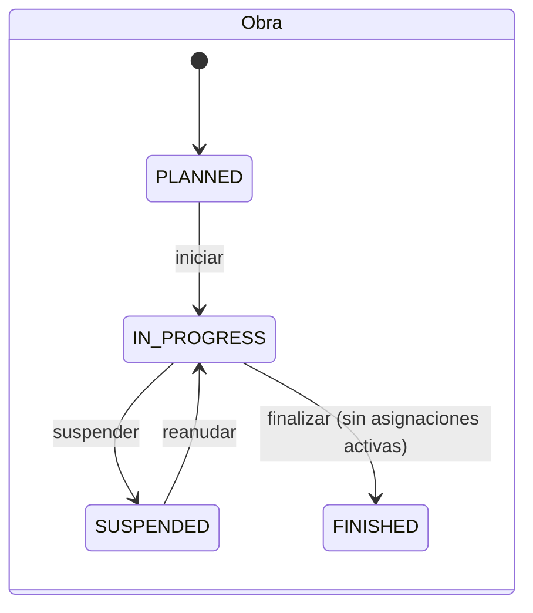
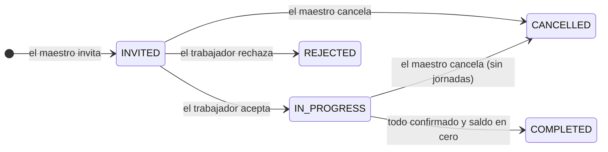
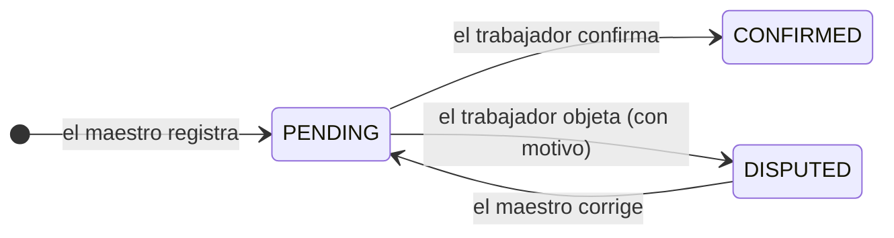
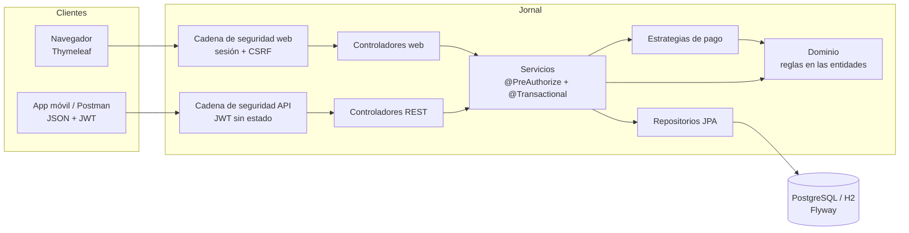

# Diseño de Jornal

Este documento explica **qué** hace el sistema y **por qué** está construido así. El README dice cómo ejecutarlo.

## 1. El problema

En Cúcuta, como en casi todo el país, los maestros de obra contratan ayudantes y oficiales **por días** (al jornal). El registro suele quedar en un cuaderno: quién vino, a qué hora entró y salió, cuánto se le adelantó. El día de pago aparecen las discusiones: "ese martes salí a las 5, no a las 4", "ya le había dado $50.000".

Jornal reemplaza el cuaderno con una regla simple: **el maestro registra, el trabajador confirma**. Solo lo que ambos aceptaron cuenta para el saldo.

## 2. Modelo de dominio

```mermaid
classDiagram
    direction LR

    class User {
        <<abstract>>
        UUID id
        DocumentType documentType
        String documentNumber
        String firstName
        String lastName
        LocalDate birthDate
        Gender gender
        String phone
        String email
        String passwordHash
        boolean active
        int failedLoginAttempts
        LocalDateTime lockedUntil
        +isAdult(today) boolean
        +registerFailedLogin(now, max, lock) boolean
    }
    class Foreman {
        String companyName
    }
    class Worker {
        Trade trade
        int yearsOfExperience
        String neighborhood
        boolean hasOwnTools
        LocalDate arlValidUntil
        boolean acceptingOffers
        +eligibilityIssues(front, today) List
    }
    class ConstructionSite {
        String name
        String address
        String city
        String buildingPermit
        LocalDate startDate
        LocalDate estimatedEndDate
        SiteStatus status
        +openFront(data) WorkFront
        +start() / suspend() / resume() / finish()
        +calculateLaborCost() BigDecimal
    }
    class WorkFront {
        String task
        Trade requiredTrade
        int openings
        BigDecimal offeredDailyWage
        LocalDate startDate
        LocalDate endDate
        Set~DayOfWeek~ workDays
        LocalTime startTime
        LocalTime endTime
        int lunchBreakMinutes
        +scheduledMinutesPerDay() int
        +availableOpenings() int
    }
    class Assignment {
        AssignmentStatus status
        LocalDate startDate
        BigDecimal dailyWage
        Integer workerRating
        Integer foremanRating
        +invite(front, worker, wage, start, now)$ Assignment
        +registerWorkDay(date, record, today, now) WorkDay
        +calculateBalance() BigDecimal
        +complete(rating, comment, today)
    }
    class WorkDay {
        LocalDate date
        LocalTime checkInTime
        LocalTime checkOutTime
        int breakMinutes
        String taskPerformed
        String disputeReason
        +value(wage, scheduled) BigDecimal
        +confirm(now) / dispute(reason, now)
    }
    class Payment {
        <<abstract>>
        String receiptNumber
        LocalDateTime paidAt
        BigDecimal amount
        PaymentMethod method
        +cancel(reason, now)
        +confirmReceipt(now)
    }
    class Advance {
        String reason
        boolean requestedByWorker
    }
    class Settlement {
        LocalDate periodStart
        LocalDate periodEnd
        boolean finalSettlement
    }

    User <|-- Foreman
    User <|-- Worker
    Payment <|-- Advance
    Payment <|-- Settlement
    Foreman "1" --> "0..*" ConstructionSite : dirige
    ConstructionSite "1" *-- "0..*" WorkFront : se divide en
    WorkFront "1" --> "0..*" Assignment : ofrece cupos
    Worker "1" --> "0..*" Assignment : acepta
    Assignment "1" *-- "0..*" WorkDay : registra
    Assignment "1" --> "0..*" Payment : se paga con
```



Decisiones del modelo:

- **`Assignment` es una clase propia** y no una tabla intermedia: une a un trabajador con un frente y guarda lo que es de esa pareja (jornal pactado, fechas, estado, calificaciones). Un trabajador puede volver al mismo frente en otra ocasión.
- **`WorkDay` no guarda dinero**, solo hechos (entrada, salida, descanso). El valor se calcula con el jornal pactado y el horario del frente: si el horario fuera mal digitado, una corrección recalcula todo sin inconsistencias.
- **Estados derivados**: el estado de una jornada (por confirmar, confirmada, objetada) y de un pago (sin confirmar, recibido, anulado) se deduce de sus fechas (`confirmedAt`, `disputedAt`, `cancelledAt`). No hay un campo de estado que pueda contradecir a las fechas.
- **Herencia**: `User` usa tablas unidas (JOINED) porque maestro y trabajador tienen datos muy distintos; `Payment` usa una sola tabla (SINGLE_TABLE) porque anticipo y liquidación comparten casi todo y se consultan juntos.
- **Dinero en `BigDecimal`**, pesos enteros y un solo redondeo al final del cálculo, para no acumular errores.
- **Ids `UUID`** asignados al crear el objeto: no se pueden adivinar recorriendo números (mitiga IDOR) y permiten `equals/hashCode` estables antes de guardar.

## 3. Ciclos de vida







## 4. Reglas de negocio

### Contratación

| Regla | Dónde se valida |
|---|---|
| Solo mayores de 18 años (el trabajo en construcción está prohibido para menores) | registro y `Worker.eligibilityIssues` |
| La ARL del trabajador debe estar vigente hasta el último día del frente | `Worker.eligibilityIssues` |
| Mismo oficio y misma ciudad de la obra; debe tener activas las invitaciones | búsqueda y servicio |
| No puede estar trabajando en otra obra en las mismas fechas (se revisa al invitar y al aceptar) | `AssignmentRepository.existsInProgressOverlapping` |
| Una invitación abierta ocupa cupo hasta que se responde | `WorkFront.availableOpenings` |

### Horario y valor de la jornada

| Regla | Fuente |
|---|---|
| Jornada diurna: entre 6:00 a. m. y 7:00 p. m. | Código Sustantivo del Trabajo, art. 160, modificado por la Ley 2466 de 2025 (desde el 25 de diciembre de 2025) |
| Máximo 42 horas a la semana (vigente desde el 15 de julio de 2026) | Ley 2101 de 2021 |
| Máximo 2 horas extra por día | Ley 50 de 1990, art. 22 |
| Hora extra diurna con recargo del 25 % | CST, art. 168 |
| La hora ordinaria pagada no puede valer menos que la del salario mínimo (SMMLV 2026: $1.750.905 / 210 h = $8.337,64) | `WagePolicy`; el valor se configura en `application.properties` |

Valor de un día: `jornal × (minutos ordinarios + minutos extra × 1,25) / minutos programados`, redondeado al peso. Ejemplos con jornal de $80.000 y 8 horas programadas:

| Entrada | Salida | Descanso | Trabajado | Valor |
|---|---|---|---|---|
| 7:00 a. m. | 4:00 p. m. | 60 min | 8 h | $80.000 |
| 7:00 a. m. | 11:00 a. m. | 0 | 4 h | $40.000 |
| 7:00 a. m. | 6:00 p. m. | 60 min | 8 h + 2 h extra | $105.000 |

### Pagos

- **Saldo** = devengado de jornadas **confirmadas** − pagos no anulados. Lo que está por confirmar u objetado se muestra aparte y no se puede pagar.
- **Anticipo**: hasta el saldo, con motivo obligatorio.
- **Liquidación de periodo**: el inicio lo fija el sistema (primer día sin liquidar), el maestro elige el corte (máximo hoy). Todas las jornadas hasta el corte deben estar confirmadas. Paga lo devengado hasta el corte menos todo lo ya pagado, es decir, descuenta los anticipos.
- **Liquidación final**: paga el saldo completo y cierra el registro de jornadas.
- Un periodo liquidado queda **cerrado**: no se registran ni corrigen jornadas dentro de él.
- **Anular**: solo pagos que el trabajador aún no confirmó; solo la última liquidación; y un anticipo ya descontado en una liquidación posterior no se anula sin anular primero esa liquidación.
- Finalizar una asignación exige todas las jornadas confirmadas y saldo cero.

## 5. Arquitectura



- **Capas**: los controladores solo traducen HTTP (validan con `@Valid` y delegan); los servicios orquestan y aplican seguridad y transacciones; las **reglas viven en el dominio** (`Assignment.registerWorkDay`, `WorkFront`, `Payment.cancel`), así se prueban sin base de datos.
- **Dos canales, una lógica**: la web y la API usan los mismos servicios; ninguna regla está duplicada.
- **DTO**: las vistas y la API reciben *records* de lectura (`dto.view`) armados dentro de la transacción; los formularios (`dto.form`) validan la entrada. Las entidades nunca salen del servicio, y Open Session In View está desactivado.
- **Strategy** para los pagos: cada tipo (anticipo, liquidación de periodo, liquidación final) es una clase con sus reglas. El servicio elige la estrategia en un `EnumMap` y falla al arrancar si falta o sobra una. Un tipo nuevo de pago es una clase nueva; nada más cambia (principio abierto/cerrado).
- **Reloj inyectado** (`Clock`): ninguna regla llama a `LocalDate.now()`. Las pruebas fijan "hoy" y simulan días de trabajo.

### SOLID en el código

| Principio | Ejemplo |
|---|---|
| Responsabilidad única | `WagePolicy` solo sabe del mínimo legal; `ViewMapper` solo convierte entidades en vistas; `SafeRedirect` solo valida destinos |
| Abierto/cerrado | Nuevo tipo de pago = nueva `PaymentStrategy`, sin tocar `PaymentServiceImpl` |
| Sustitución de Liskov | `Advance` y `Settlement` refinan `cancellationIssue()` sin romper el contrato de `Payment.cancel()` |
| Segregación de interfaces | Un servicio por área (`SiteService`, `WorkDayService`, `PaymentService`…) en lugar de uno gigante |
| Inversión de dependencias | Los controladores dependen de interfaces de servicio; las implementaciones reciben repositorios, reloj y estrategias por constructor |

## 6. Seguridad (OWASP Top 10)

| Riesgo | Medida |
|---|---|
| A01 Control de acceso | Rol por URL **y** por método (`@PreAuthorize`). Además, el id que llega al servicio debe ser el del usuario autenticado (`#foremanId == principal.id()`). Toda consulta filtra por dueño: un recurso ajeno responde **404**, no 403, para no confirmar que existe. Ids UUID. |
| A02 Fallas criptográficas | BCrypt (costo 12) para las claves; JWT firmado con HS256 y secreto de mínimo 256 bits que viene de una variable de entorno; cookie de sesión `HttpOnly`, `SameSite=Lax` y `Secure` en producción. |
| A03 Inyección | JPQL con parámetros enlazados (probado con `' OR '1'='1`); Thymeleaf escapa todo el texto (probado con `<script>`); CSP estricta sin scripts ni estilos en línea. |
| A04 Diseño inseguro | Reglas de negocio en el dominio con pruebas; bloqueo optimista para que dos pagos simultáneos no paguen dos veces el mismo saldo. |
| A05 Configuración | Actuator solo expone `health` e `info` en producción (nunca `env`); Swagger solo en dev; errores sin stack trace. |
| A07 Autenticación | Bloqueo de 15 minutos tras 5 intentos fallidos; mismo mensaje exista o no el correo (también en el registro); clave mínima de 10 caracteres con letras y números. |
| A09 Registro | Logs con ids y eventos, nunca correos completos, claves ni tokens. |

La web usa **sesión con CSRF** (el navegador envía la cookie solo); la API usa **JWT sin estado y sin CSRF** (el header `Authorization` nunca lo pone el navegador por su cuenta). Son dos `SecurityFilterChain` separadas.

## 7. API REST

Documentación interactiva en dev: `http://localhost:8080/swagger-ui.html`.

| Método | Ruta | Rol | Respuestas |
|---|---|---|---|
| POST | `/api/auth/login` | público | 200 token, 401 |
| GET | `/api/auth/me` | cualquiera | 200 |
| GET / POST | `/api/obras` | maestro | 200, 201, 400, 422 |
| GET | `/api/obras/{id}` | maestro | 200, 404 |
| POST | `/api/obras/{id}/estado?accion=START` | maestro | 204, 422 |
| POST | `/api/obras/{id}/frentes` | maestro | 201, 422 |
| GET | `/api/frentes/{id}/candidatos` | maestro | 200 |
| POST | `/api/frentes/{id}/invitaciones` | maestro | 201, 422 |
| GET | `/api/asignaciones`, `/api/asignaciones/{id}` | maestro | 200, 404 |
| POST | `/api/asignaciones/{id}/jornadas` | maestro | 201, 422 |
| PUT | `/api/asignaciones/{id}/jornadas/{jornada}` | maestro | 204, 422 |
| POST | `/api/asignaciones/{id}/pagos/cotizacion` | maestro | 200, 422 |
| POST | `/api/asignaciones/{id}/pagos` | maestro | 201, 409, 422 |
| GET | `/api/mis-asignaciones`, `/api/mis-asignaciones/{id}` | trabajador | 200, 404 |
| POST | `/api/mis-asignaciones/{id}/respuesta` | trabajador | 204, 422 |
| POST | `/api/jornadas/{id}/confirmacion`, `/objecion` | trabajador | 204, 422 |
| POST | `/api/pagos/{id}/confirmacion` | trabajador | 204, 422 |

Todos los errores tienen la misma forma:

```json
{
  "timestamp": "2026-10-29T09:15:00-05:00",
  "status": 422,
  "error": "Unprocessable Entity",
  "code": "PAGO_ANTICIPO_EXCEDE_SALDO",
  "message": "El anticipo no puede superar el saldo confirmado ($240.000).",
  "path": "/api/asignaciones/3f2b…/pagos"
}
```

| Código | Cuándo |
|---|---|
| 400 | Datos mal formados o campos inválidos (`fieldErrors`) |
| 401 | Sin token, token alterado o expirado, credenciales inválidas |
| 403 | El rol no tiene permiso |
| 404 | No existe **o no es tuyo** |
| 409 | Conflicto de concurrencia (otro cambio al mismo tiempo) |
| 422 | Regla de negocio incumplida (el código dice cuál) |

## 8. Plan de pruebas

La pirámide: muchas pruebas rápidas del dominio, menos de servicio y web, y pocas de punta a punta.

| Nivel | Qué prueba | Herramientas | Clases |
|---|---|---|---|
| Unitarias del dominio | Cálculo de jornadas, horarios legales, ciclo de vida, saldos, reglas de anulación | JUnit 5, AssertJ, `@ParameterizedTest` | `WorkDayTest`, `WorkFrontTest`, `AssignmentTest`, `ConstructionSiteTest`, `UserTest`, `WorkerTest`, `PaymentStrategiesTest` |
| Unitarias de utilidades | Valor en letras, festivos, formatos, mínimo legal, redirección segura, JWT, bloqueo por intentos | JUnit 5 | `AmountInWordsTest`, `ColombianHolidaysTest`, `FormatsTest`, `WebSupportTest`, `JwtServiceTest`, `LoginAttemptListenerTest` |
| Servicios | Orquestación con repositorios simulados (escuela clásica: se simula solo la base de datos y se verifica el resultado, no la implementación) | Mockito | `*ServiceImplTest` |
| Repositorios | Consultas de propiedad, cruces de fechas, búsqueda segura, esquema Flyway = mapeo JPA | `@DataJpaTest` | `RepositoryQueriesTest` |
| Controlador aislado | Códigos HTTP y JSON de la API sin levantar toda la aplicación | `@WebMvcTest` + `@MockitoBean` | `ForemanApiControllerTest` |
| Integración web y API | Seguridad, CSRF, bloqueo, encabezados, IDOR, XSS, JWT, formato de errores | `@SpringBootTest` + MockMvc | `WebSecurityIT`, `IdorAndXssIT`, `ApiIT` |
| Flujo completo | Una asignación de principio a fin con el reloj avanzando día a día; al final lo devengado = lo pagado | `@SpringBootTest` | `PayrollFlowIT` |
| Interfaz | Cada pantalla de cada rol se renderiza sin errores ni textos faltantes | MockMvc + datos de demo | `PagesRenderIT` |
| Punta a punta | El maestro corrige una objeción desde el navegador y el trabajador la ve | HtmlUnit + Selenium, Page Objects | `ForemanCorrectsDisputeE2E` |
| API externa | Colección ejecutable contra la aplicación en marcha | Postman / Newman | `postman/` |

Nombres de prueba: `metodo_condicion_resultadoEsperado`, por ejemplo `register_pagoQueNoCumpleLasReglas_noGastaUnNumeroDeComprobante`.

Cobertura: JaCoCo exige **mínimo 70 % de líneas** en `mvn verify` (la construcción falla si no se cumple).
